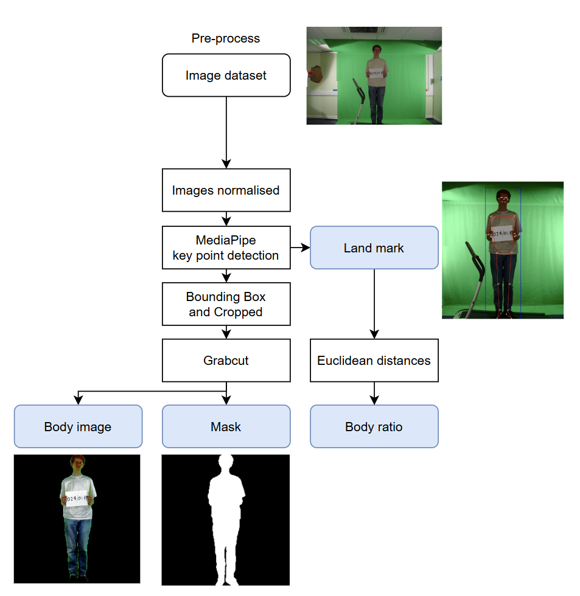
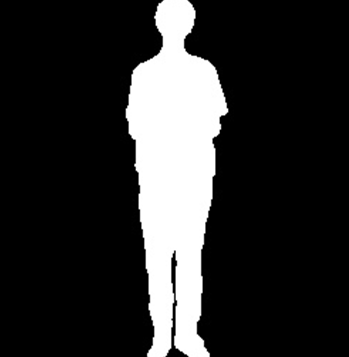
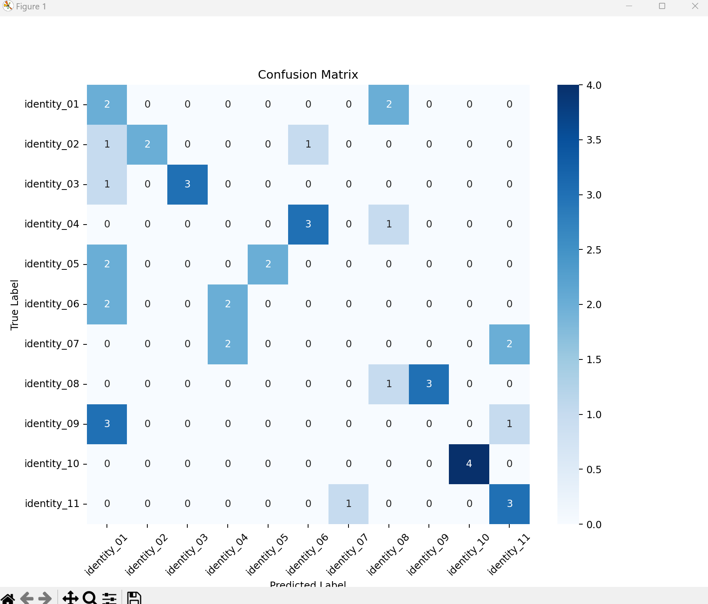
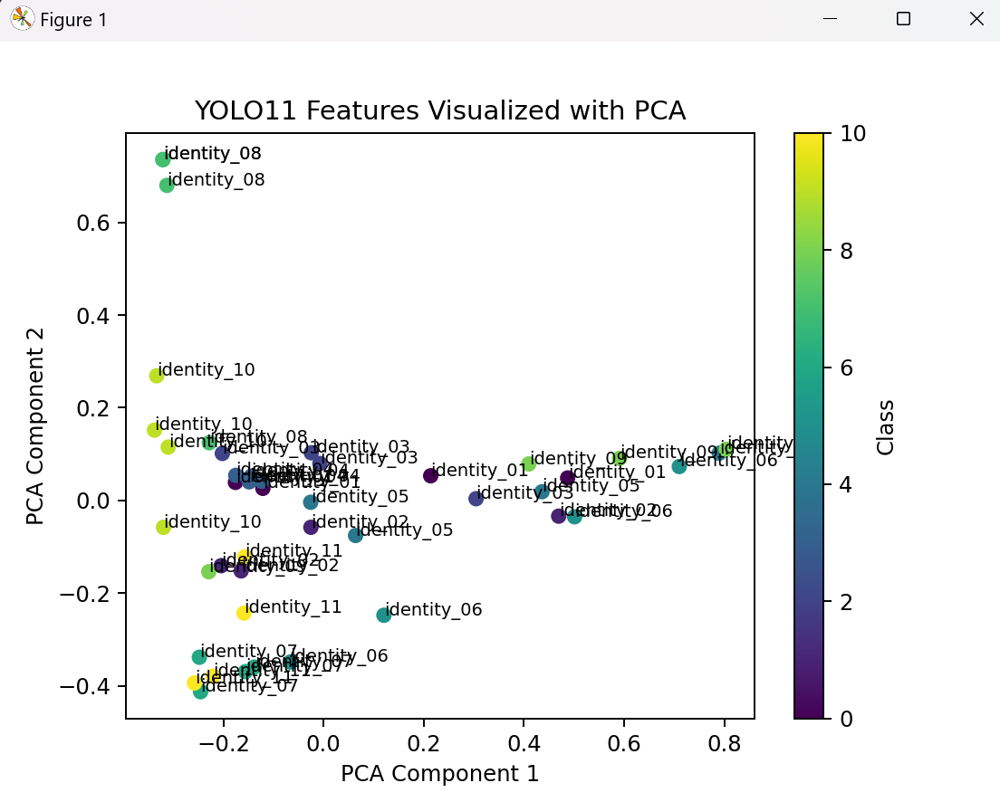

# Body Shape Recognition — COMP6211 Biometrics Coursework

Coursework for COMP6211 Biometrics at the University of Southampton: identifying people from full-body images (front and side views) of 11 subjects on a treadmill in front of a green screen. The project compares hand-crafted shape features with learned models.

## Pipeline

<p align="center"></p>

1. **Pre-processing** — normalise images, detect body key points with MediaPipe Pose, crop to the body bounding box, and segment the person with GrabCut. Outputs are the body image, a binary mask and landmark coordinates.

   <p align="center"><br><em>Binary body mask produced by GrabCut</em></p>

2. **Feature extraction** — hand-crafted features computed from the masks, grey images and landmarks:
   colour histograms, Hu moments, 2D Gabor filters, contour geometry, Otsu binarisation, skeleton plots, LBP, HOG and body ratios (Euclidean distances between landmarks).
3. **Classification** — SVMs on HOG / LBP / body-ratio features, a random forest on landmark distances, and a VGG16 transfer-learning CNN (Keras).
4. **Evaluation** — accuracy and confusion matrices on the test set; within/between-class distance and SNR analysis of each feature set.

## Repository structure

```
├── src/
│   ├── 01Image_Preprocessing/   # MediaPipe + GrabCut segmentation, data augmentation, landmark extraction
│   ├── 02Feature_extraction/    # Hu moments, Gabor, HOC, Otsu, landmark-ratio features
│   ├── 03Models/                # CNN.py (VGG16 transfer learning), Models_Test.py (SVM evaluation)
│   ├── 04Testing/               # Feature_joblib.py — evaluate saved SVM models, plot confusion matrices
│   ├── Analysis/                # Feature analysis (within/between distance, SNR), colour histograms, figures
│   └── main.py                  # Hu-moment extraction and comparison plot
├── data/
│   ├── training/                # 88 original images, augmented images, body crops, masks
│   ├── testing/                 # 22 test images (11 subjects × front/side), organised by identity
│   └── results/                 # Extracted features (CSV), analysis plots, trained models (*.joblib)
├── cnn_identity_model.h5 / .keras   # Trained CNN (Git LFS)
└── vae_model.weights.h5             # VAE weights (Git LFS)
```

Model files are stored with **Git LFS**. Run `git lfs install` before cloning, or `git lfs pull` afterwards, to download them.

## Setup

Python 3.9 was used. Install the libraries imported by the scripts:

```bash
pip install opencv-python mediapipe numpy pandas scikit-learn scikit-image tensorflow matplotlib seaborn scipy joblib imutils
```

`src/01Image_Preprocessing/landmark.py` additionally needs `openpifpaf`.

> Most scripts use absolute Windows paths such as `C:\Biometrics\data\...`. Clone the repository to `C:\Biometrics`, or edit the path variables at the top of each script before running.

## Results

Hand-crafted features performed poorly because they are sensitive to clothing, lighting and pose changes (correct classification rate roughly 10–20%). A YOLO-based classifier performed best: 50% CCR with hard voting and 59.09% with soft voting, with an EER of 0.32.

<p align="center">
  
  
</p>

The PCA plot of YOLO11 features shows some identities forming clear clusters (e.g. identity 08 and 10) while others overlap, which explains the remaining confusion between subjects.

> The YOLO training code is not included in this repository.

## Future work

- More images per subject to improve dataset diversity
- Generative augmentation (e.g. CycleGAN) for clothing and background variation
- Metric-learning losses such as Triplet or ArcFace loss to separate identities

## Author

Yu-Cheng Lai ([YCL-Jeff](https://github.com/YCL-Jeff)), University of Southampton
